 

 

I'm a **Full Stack Engineer** who builds the whole path of a feature: a fast, accessible **React** interface, and the secure, well-tested **Node.js / NestJS** API behind it. I care about clean architecture, measurable performance, and shipping things that hold up in production.

Right now I work on **cybersecurity web applications at RYVOR**, build **CRM and e-commerce products at HammerLoad**, and teach backend development to university students.

 

## Impact

<table>
<tr>
<td width="33%" align="center" valign="top">
<h3>82% → 96%</h3>
Stripe payment success rate after reworking the payment flow at Qowa
</td>
<td width="33%" align="center" valign="top">
<h3>−40%</h3>
Failed-checkout support tickets, from the same change
</td>
<td width="33%" align="center" valign="top">
<h3>15+</h3>
Students taught Node.js and REST API design at IEEE MTI
</td>
</tr>
</table>

 

## Experience

<table>
<tr>
<td width="24%" valign="top"><b>RYVOR</b> Software Engineer Oct 2026 – Present UAE · Remote</td>
<td valign="top">
Node.js services and REST APIs for cybersecurity-focused applications. Cut React load times and unnecessary re-renders, tuned queries and API latency across the stack, and ship with the frontend and security teams in Agile sprints.
</td>
</tr>
<tr>
<td valign="top"><b>HammerLoad</b> Full Stack Engineer Aug 2026 – Present Cairo · Remote</td>
<td valign="top">
End-to-end client products (CRM, e-commerce, business management) in React.js, TypeScript and Node.js: customer and order workflows, third-party integrations, and Docker deployments on AWS and DigitalOcean.
</td>
</tr>
<tr>
<td valign="top"><b>Qowa</b> Junior Software Engineer Feb 2026 – Oct 2026 Riyadh · Remote</td>
<td valign="top">
Modular NestJS + TypeScript APIs (controllers, services, repositories), PostgreSQL + Prisma schemas, transactions and migrations, Redis caching on hot endpoints, and Dockerized environments. Raised payment success from 82% to 96%.
</td>
</tr>
<tr>
<td valign="top"><b>Cyparta</b> Backend Developer Intern Jun 2025 – Aug 2025 Cairo</td>
<td valign="top">
Architected a modular Node.js / Express backend for an online store (product, cart, order and user domains) with Stripe multi-currency payments.
</td>
</tr>
</table>

 

## Selected work

<table>
<tr>
<td width="50%" valign="top">

### BioReza
E-commerce platform for skincare & beauty · 2026

Production storefront built end to end: Next.js + Tailwind on the front, NestJS + PostgreSQL behind it. Catalog, reviews, cart and checkout with local payments (Cash on Delivery, Vodafone Cash, InstaPay), webhook verification and idempotent orders. Redis caching, Docker, DigitalOcean, S3 for media.

</td>
<td width="50%" valign="top">

### [Social Media API](https://github.com/mohamedelsayed29/social-media-api)
Real-time backend · 2026

JWT auth with refresh-token rotation and revocation, Google OAuth, posts, comments and friend requests, and real-time messaging over Socket.IO. Media on AWS S3 with multipart uploads and presigned URLs, validated with Zod.

</td>
</tr>
</table>

 

## Toolbox

<table>
<tr>
<td width="20%"><b>Frontend</b></td>
<td></td>
</tr>
<tr>
<td><b>Backend</b></td>
<td></td>
</tr>
<tr>
<td><b>Data</b></td>
<td></td>
</tr>
<tr>
<td><b>Cloud & DevOps</b></td>
<td></td>
</tr>
<tr>
<td><b>Testing</b></td>
<td></td>
</tr>
</table>

<b>Also:</b> JWT · RBAC · OAuth 2.0 · OWASP practices · Swagger / OpenAPI · Socket.IO · React Testing Library · Clean Architecture · SOLID · Agile / Scrum

 

## Teaching

- **Backend Instructor**, IEEE MTI Student Branch · Feb 2026 – Present. Node.js and REST API design for 15+ students, mentored through hands-on projects.
- **Frontend Instructor (Volunteer)**, GDG on Campus MTI · Jul 2025 – Dec 2025. HTML, CSS and JavaScript through React, with weekly code reviews on student projects.

## Education

**B.Sc. Computer Science**, Modern University for Technology and Information (MTI), Cairo · 2022 – 2026
 Full Stack Development Diploma, Route Academy · 2024 – 2025

 

Open to full-time and remote roles · <a href="mailto:mohamed.elsayed.a.dev@gmail.com">mohamed.elsayed.a.dev@gmail.com</a>

